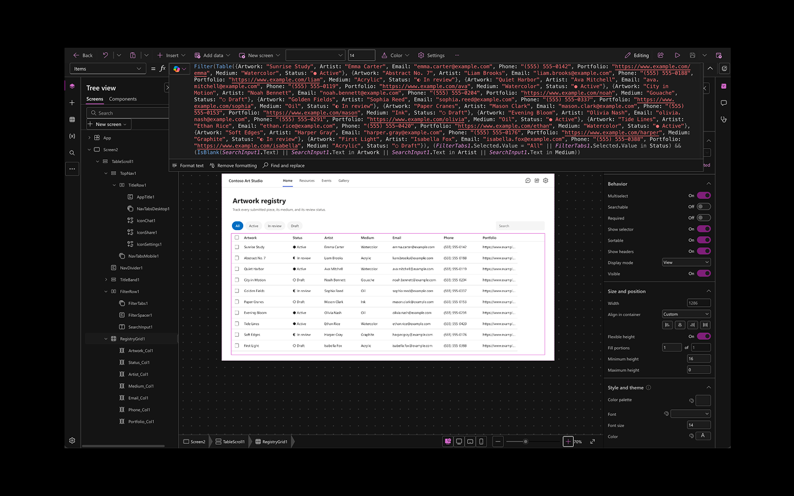
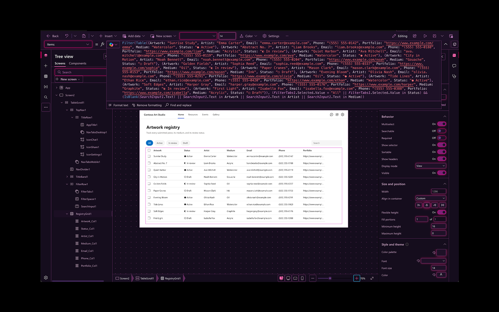

# Dark Mode for Power Platform

A carefully crafted dark theme for **Power Apps canvas Studio**, the maker portal and **Power Automate**, and if you turn it on, **SharePoint**. It is a Chrome / Edge extension (Manifest V3).

- Every part of Studio's chrome goes dark: command bar, formula bar (Monaco), tree view, Insert / Data / Variables panes, properties pane, dialogs, menus, tooltips, settings, Copilot and comments panes.
- Power Automate goes dark too: home, My flows, flow details, the new and the classic flow designer, templates, approvals and monitoring, and the Flows pages the Power Apps portal embeds from it.
- SharePoint is opt-in: pages, lists, libraries, menus, panels and the classic settings pages go dark in the site's own theme colour. The extension asks for SharePoint access only when you switch it on, and gives the access back when you switch it off.
- Each product keeps its own accent colour (Power Apps purple, Power Automate blue, a SharePoint site's theme colour), read from the page's own Fluent theme. Or switch the Style to **Neon** for a cyberpunk hot-pink look.
- **Your app is never recoloured.** The canvas that renders the app you are designing is excluded from every rule, so what you see is what your users get. Colour previews (swatches, the colour picker) are excluded the same way, so they show the colour you are choosing.
- Accessible by design: every text/surface pairing the theme produces is checked against WCAG 2.1 AA (AAA in the high-contrast setting), focus rings are preserved, Windows High Contrast mode is respected, and the extension never changes the DOM structure or ARIA of the page.
- Zero telemetry, no accounts, no network requests other than fetching Studio's own stylesheets.

## Screenshots

**Classic** style in canvas Studio. The app being designed keeps its own light colours.



**Neon** style in canvas Studio.



## Why not a general dark-mode extension?

For Power Platform work, a dedicated theme does things a general one cannot, and those things matter in a design tool. The comparison below follows from how general dark modes work (they recolour every page by the same rules); it is not a benchmark against any particular product.

- **Your app stays true.** General tools recolour everything, including the canvas that shows the app you are designing, so a white app looks dark and you cannot judge the real design. This extension never touches the canvas.
- **Colour pickers show real colours.** A general tool recolours swatches and gradients like any other element, so the colour you pick is not the colour you see. Here, swatches and the colour picker are left exactly as they are.
- **Built for Studio's structure.** It recolours Studio's own colour settings with Microsoft's own dark mapping, and handles Studio's special cases: sprite icons, the forced styles behind property labels, and the command-bar colours.
- **Tested readability.** Every colour pairing the theme produces is checked for WCAG contrast in the test suite, and a built-in audit checks real pages. General tools make no such guarantee.
- **Narrow access.** It runs only on Power Platform sites, and on SharePoint only while you allow it. A general dark mode usually asks to read and change data on every site you visit.

What general tools do better:

- **Every site.** They theme the whole web.
- **Maturity.** They are long-established and widely tested.
- **Resilience.** A Studio update can break a specific fix here until the extension is updated; a general tool degrades more evenly.

## Install (unpacked)

1. Clone or download this repository.
2. Open `chrome://extensions` (or `edge://extensions`), turn on **Developer mode**.
3. Click **Load unpacked** and select the repository folder (the one containing `manifest.json`).
4. Open <https://make.powerapps.com> and edit any canvas app, or open <https://make.powerautomate.com>. The page turns dark immediately; use the toolbar popup or **Alt+Shift+D** to toggle.

After pulling a new version, press the reload arrow on the extension's card in `chrome://extensions`, then reload open Power Apps and Power Automate tabs. Chrome applies new host permissions (1.1.0 adds Power Automate) on that reload.

A packaged zip for store submission is produced by `npm run package` (lands in `dist/`).

## Settings

Open the toolbar popup or the full options page (`All settings`).

| Setting | What it does |
| --- | --- |
| Dark mode | Master switch (also **Alt+Shift+D**, configurable at `chrome://extensions/shortcuts`). |
| Appearance | *Always dark*, or *Follow system* (dark only while your OS colour scheme is dark). |
| Surface | *Dim*, *Dark* (Fluent UI's dark theme greys) or *Black* for OLED-style surfaces. |
| Style | *Classic* keeps each product's own colours. *Neon* is a cyberpunk take: violet-black surfaces, hot-pink accents everywhere and cyan focus rings. |
| High contrast text | Brighter text and stronger borders targeting WCAG AAA. Turns on automatically when the OS asks for more contrast. |
| Dark canvas backdrop | Darkens the dotted work area around the app. Turn it off to keep the light backdrop and judge your app against a neutral frame. |
| Adapt two-tone icons | Lightens dark neutral strokes in Studio's control icons; coloured parts are never changed. |
| Developer diagnostics | Off by default. Lets the console of a maker page inspect the pages it embeds (Studio, the Flows pages) and try CSS in them. Only for debugging this extension. |
| Portal pages and Power Automate | Also theme the make.powerapps.com pages (Home, Apps, Tables, Flows…) and Power Automate, including the flow designer. Studio is always themed. |
| SharePoint | Off by default. Also theme SharePoint sites. Turning it on asks Chrome for access to SharePoint (`*.sharepoint.com` and the government and China clouds); turning it off removes that access. Settings sync between browsers but access does not, so each browser asks once. OneDrive is not themed: it has its own dark mode. |

Settings sync with your browser profile and apply instantly to open tabs.

## How it works

Studio mixes several styling systems, so a single trick would never cover all of it. The extension layers four mechanisms, all computed in the content script with no round trips:

1. **Fluent UI v9 design tokens.** Studio's modern UI reads colours from `--colorNeutralBackground1`-style custom properties. The extension redefines all 348 colour tokens with Fluent's own dark-theme mapping, re-derived for the status/persona palettes (`tools/gen-tokens.mjs`). The brand ramp follows the page: the root FluentProvider's light brand colour seeds it, so Studio keeps Power Apps' exact purple ramp and Power Automate gets a blue one. Tokens that Studio uses in the "wrong" role (a surface token as a text colour) are retargeted to a legible variant.
2. **CSSOM rewriting.** Every stylesheet (Fluent v8 merge-styles, Aphrodite, Griffel, Monaco, React Flow, Studio's own CSS, including cross-origin files fetched through CORS or the service worker) is walked rule by rule. Each colour-bearing declaration is re-emitted with its dark counterpart, preserving selectors, media queries and `!important`, and variables that hold colours get typed variants so `var()` usages map correctly by role (background, text, border, shadow). Shorthands declared with `var()` (`background: var(--x)`, `border: 1px solid var(--y)`) are read by name, since the browser reports their longhands as empty. Mapped text colours are lightened until they meet WCAG AA on the raised surfaces of menus and dialogs. A MAIN-world hook reports `insertRule` traffic so CSS-in-JS updates are picked up without polling.
3. **Inline colours.** Elements with colours in their `style` attribute or SVG `fill` / `stroke` attributes receive `--capd-i-*` variables and a marker attribute; static rules apply them. The page's own declarations are never removed, so turning the theme off is lossless.
4. **Hand-tuned rules** for the places where a generic mapping is not good enough (canvas backdrop, formula bar, elevated surfaces, scrollbars, focus rings, light hero artwork). SVG icons that carry no fill at all, and so paint in SVG's default black, take the surrounding text colour instead.

Everything is wrapped in a CSS `@scope (:root) to (#publishedCanvas, .app-canvas)` donut, which is how the designer canvas stays untouched. A cached per-origin state applies a dark baseline at `document_start`, so there is no white flash.

## Development

```bash
npm test            # unit tests + WCAG contrast gate (node:test, no dependencies)
npm run build       # bundles theme/*.css into src/content/generated/theme-css.js and validates the manifest
npm run tokens      # regenerates the Fluent dark token spec from tools/data/fluent-light-tokens.json
npm run icons       # renders icons/*.png from a tiny built-in rasteriser
npm run standalone  # builds dist/standalone/capd-standalone.js for browser-driven checks without installing
npm run package     # dist/dark-mode-for-power-platform-<version>.zip
```

Load the folder as an unpacked extension after `npm run build`; the generated files are committed so a fresh clone loads as-is.

Diagnostics: in any themed frame's console, `CAPD.stats()` reports the engine state and `CAPD.debug = true` enables verbose logging.

`CAPD.audit()` checks the rendered page: text below WCAG AA (3:1 for large text), and SVG icons and icon-font glyphs below 3:1, measured against the real surface behind them (gradient stops included, the designer canvas excluded). It also lists text drawn over background images, which no colour check can judge. Studio and the Flows pages run in cross-origin frames; from the maker page's console you can ask a frame for its audit instead of switching console contexts:

```js
addEventListener('message', (e) => e.data?.type === 'capd:audit-result' && console.log(e.data));
document.querySelector('iframe[name="EmbeddedStudio"]').contentWindow.postMessage({ type: 'capd:audit' }, '*');
```

Frames answer only their direct parent, and only on a Power Apps or Power Automate maker origin (on SharePoint, a SharePoint origin).

With **Developer diagnostics** switched on in the options, the same bridge also answers `{ type: 'capd:inspect', x, y }` (or `selector`) with the elements there and the colour rules that apply to them, `{ type: 'capd:probe-css', css }` by installing test CSS in the frame (an empty string removes it), and `{ type: 'capd:override', settings: { look: 'neon' } }` by previewing settings in that page until it reloads.

## Compatibility

- Chrome and Edge 120+ (uses CSS `@scope`, MV3 `world: "MAIN"` content scripts).
- make.powerapps.com, including preview/test, GCC (`make.gov.powerapps.us`), GCC High, DoD and 21Vianet hosts, and the regional Studio authoring frames.
- make.powerautomate.com, including its GCC, GCC High and 21Vianet hosts, and the Power Automate pages embedded in the Power Apps portal.
- SharePoint Online (opt-in): `*.sharepoint.com` (worldwide and GCC), `*.sharepoint.us` (GCC High), `*.sharepoint-mil.us` (DoD) and `*.sharepoint.cn` (21Vianet). Modern and classic pages; SharePoint frames are themed only inside a SharePoint page, not where Teams or another site embeds them. OneDrive (`*-my.sharepoint.com`) is left alone.
- Published apps and the player are deliberately out of scope and never touched, including Power Apps forms and apps embedded in SharePoint.

## Licence

MIT — see `LICENSE`. "Power Apps" and "Fluent UI" are trademarks of Microsoft Corporation; this is an independent project, not affiliated with or endorsed by Microsoft.
